# Mining Developer Expertise from Bug Tracking Systems using the Author-Topic Model

Daniel Atzberger, Jonathan Schneider, [Willy Scheibel](https://orcid.org/0000-0002-7885-9857), [Daniel Limberger](https://orcid.org/0000-0002-9111-4809), [Matthias Trapp](https://orcid.org/0000-0003-3861-5759), and [Jürgen Döllner](https://orcid.org/0000-0002-8981-8583)

*Proceedings of the 17th International Conference on Evaluation of Novel Approaches to Software Engineering - ENASE (ENASE '22)*, April 25–26, 2022, online. SciTePress, pp. 107–118.

[](https://doi.org/10.5220/0011045100003176) [](https://doi.org/10.5281/zenodo.24121766) · [ResearchGate](https://www.researchgate.net/publication/360230384)

**Best Student Paper Award**, ENASE 2022.

> During the software development process, software defects, so-called bugs, are captured in a semi-structured manner in a bug tracking system using textual components and categorical features.
> It is the task of the triage owner to assign open bugs to developers with the required skills and expertise.
> This task, known as *bug triaging*, requires in-depth knowledge about a developer's skills.
> Various machine learning techniques have been proposed to automate this task, most of these approaches apply topic models, especially Latent Dirichlet Allocation, for mining the textual components of bug reports.
> However, none of the proposed approaches explicitly models a developer's expertise.
> In most cases, these algorithms are treated as a black box, as they allow no explanation about their recommendation.
> In this work, we show how the Author-Topic Model, a variant of Latent Dirichlet Allocation, can be used to capture a developer's expertise in the latent topics of a corpus of bug reports from the model itself.
> Furthermore, we present three novel bug triaging techniques based on the Author-Topic Model.
> We compare our approach against a baseline model, that is based on Latent Dirichlet Allocation, on a dataset of 18 269 bug reports from the Mozilla Firefox project collected between July 1999 to June 2016.
> The results show that the Author-Topic Model can outperform the baseline approach in terms of the Mean Reciprocal Rank.

<p><a href="atzberger2022-mining-expertise-as-submitted.pdf">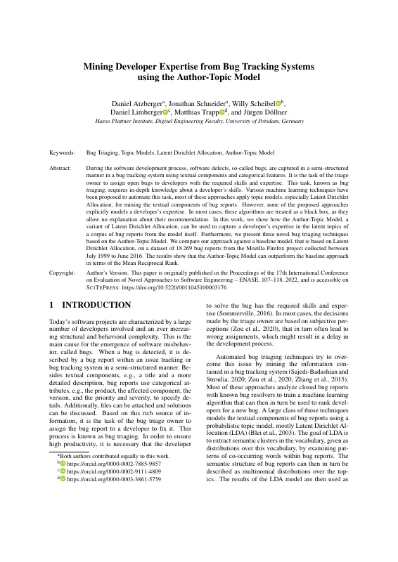</a> <a href="atzberger2022-mining-expertise-as-submitted.pdf">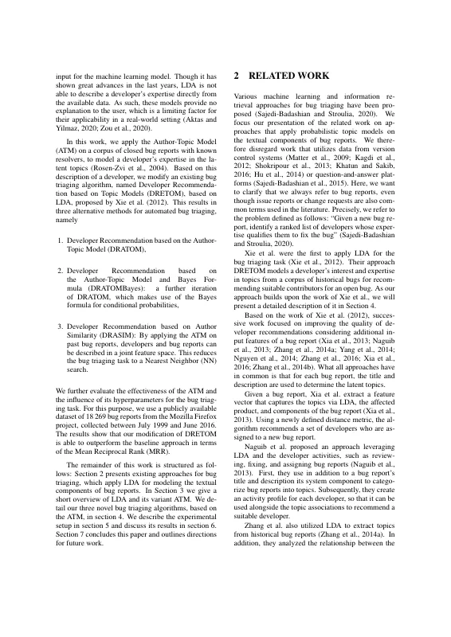</a> <a href="atzberger2022-mining-expertise-as-submitted.pdf">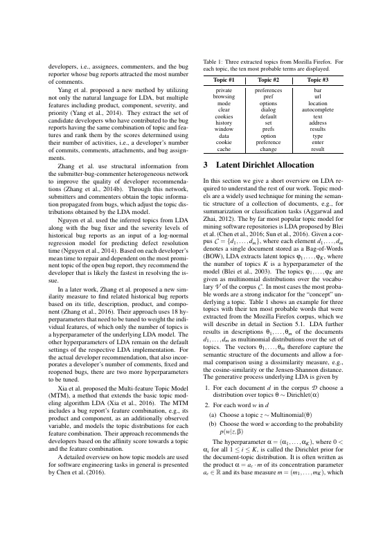</a> <a href="atzberger2022-mining-expertise-as-submitted.pdf">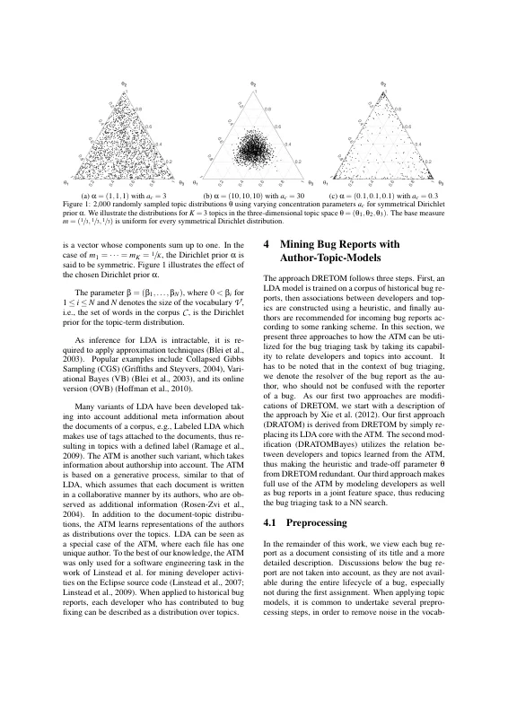</a></p>
<details><summary>Remaining 8 pages</summary><p><a href="atzberger2022-mining-expertise-as-submitted.pdf">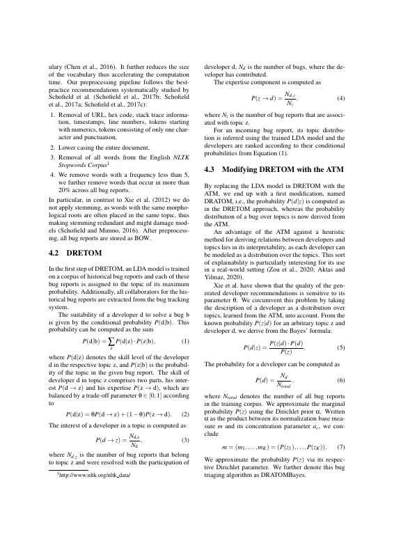</a> <a href="atzberger2022-mining-expertise-as-submitted.pdf">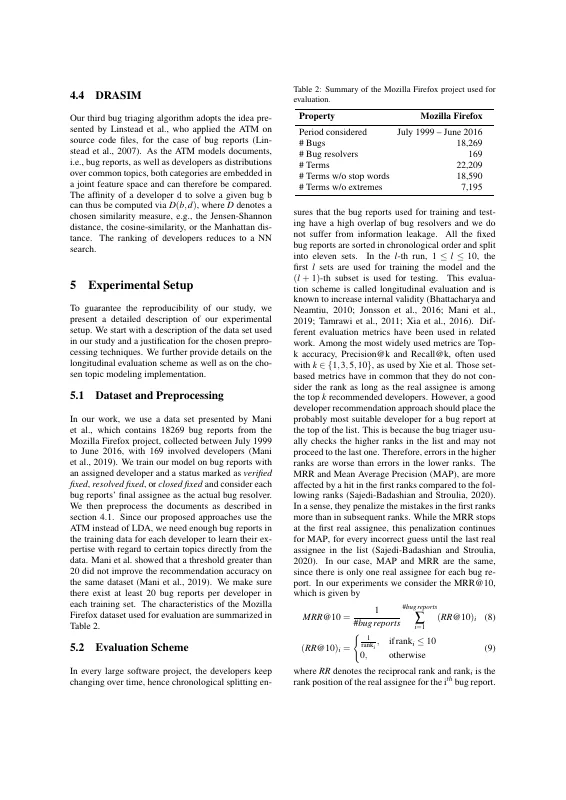</a> <a href="atzberger2022-mining-expertise-as-submitted.pdf">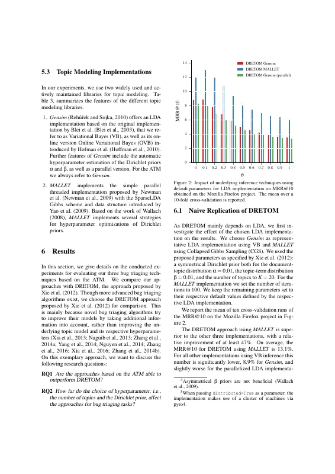</a> <a href="atzberger2022-mining-expertise-as-submitted.pdf">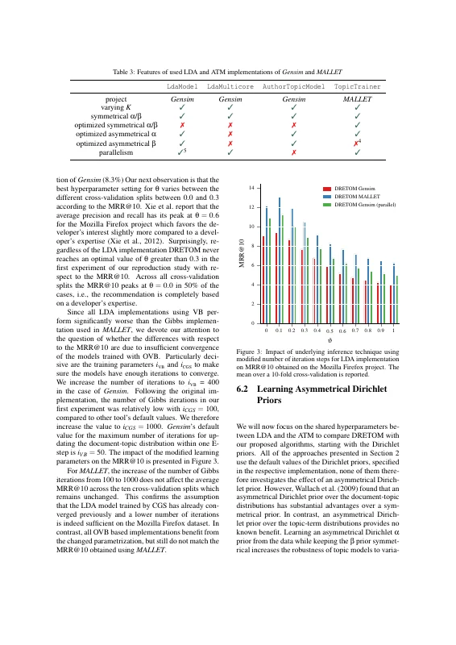</a> <a href="atzberger2022-mining-expertise-as-submitted.pdf">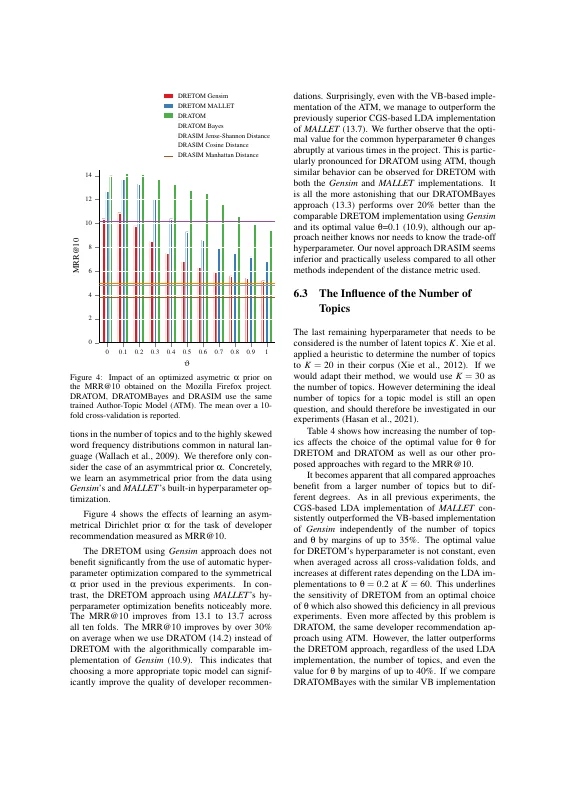</a> <a href="atzberger2022-mining-expertise-as-submitted.pdf">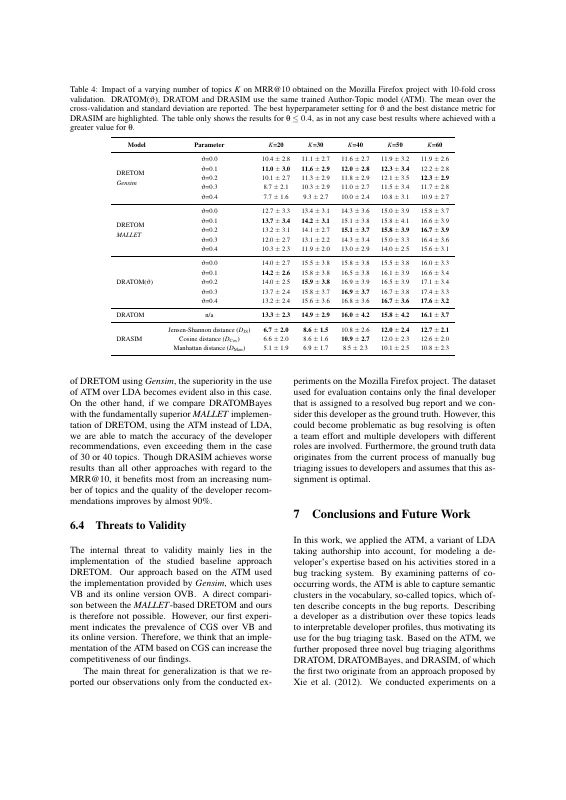</a> <a href="atzberger2022-mining-expertise-as-submitted.pdf">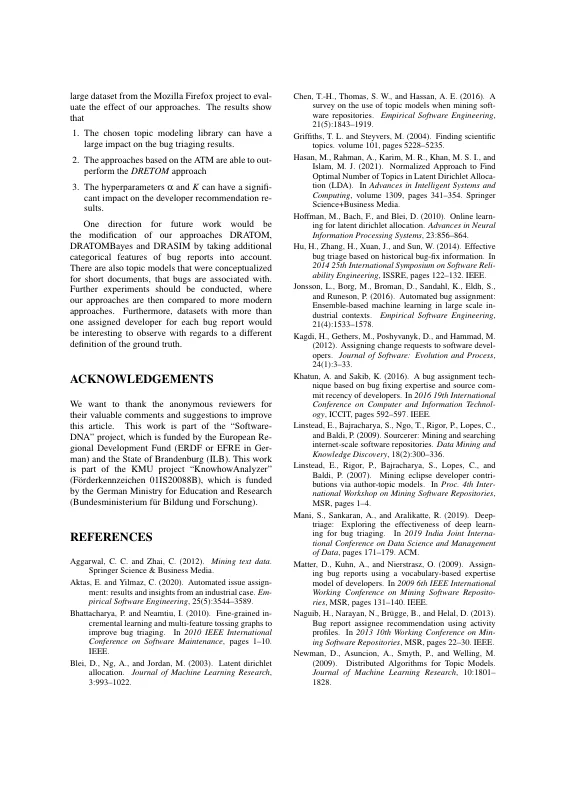</a> <a href="atzberger2022-mining-expertise-as-submitted.pdf">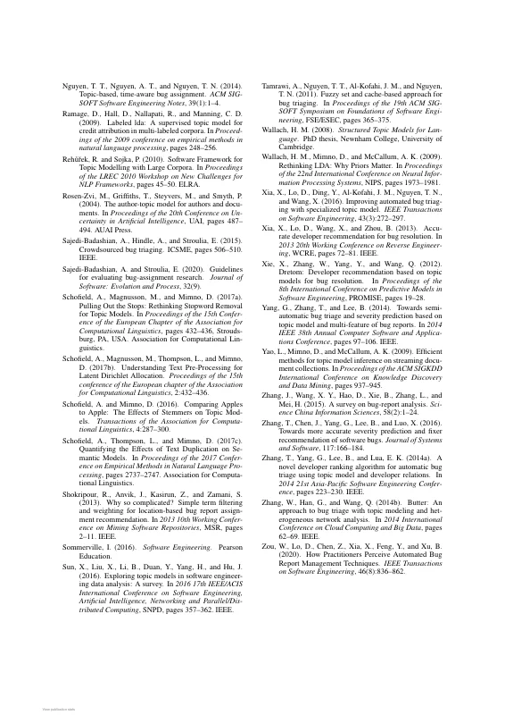</a></p></details>

## Contents

- [`src/`](src/) – LaTeX sources of the author's version (SciTePress conference template)
- [`atzberger2022-mining-expertise-as-submitted.pdf`](atzberger2022-mining-expertise-as-submitted.pdf) – author's version as published on ResearchGate (without the ResearchGate cover page); the publisher's typeset version differs only in header/footer
- [`build.sh`](build.sh) – reproducible build with TeX Live 2021 (podman or docker)
- [`preview/`](preview/) – page previews for this README

## Build

```bash
./build.sh        # → build/Main.pdf
```

The SciTePress template files (`article.cls`, `SCITEPRESS.sty`, `apalike.sty`, `apalike.bst`) are bundled in `src/` and take precedence over the TeX Live versions.
`atzberger2022-mining-expertise-as-submitted.pdf` was built with TeX Live 2021 (pdfTeX 1.40.23), hence the TeX Live 2021 container; the build reproduces it (identical text and layout).
On `main`, the build produces the revised version (`v1.1-revised`). Check out `v1.0-camera-ready` to reproduce `atzberger2022-mining-expertise-as-submitted.pdf`.
The build compiles a scratch copy of `src/` inside the container, so the ORCID logo (`orcid.eps`) can be converted to PDF.

## Versions

- [`v1.0-camera-ready`](https://github.com/dl-archive/article.2022-enase-mining-expertise/tree/v1.0-camera-ready) – sources of the author's version (camera-ready plus the SciTePress author-version notice on the first page)
- [`v1.1-revised`](https://github.com/dl-archive/article.2022-enase-mining-expertise/tree/v1.1-revised) – author's revised version (2026-11-11): ORCID iD, grammar and typo fixes, see [Revisions](#revisions)

## Revisions

`v1.1-revised` (2026-11-11) corrects errors in the author's version without changing its content or layout.
Every page carries the note "Author's revised version (2026-11-11). Version of record: https://doi.org/10.5220/0011045100003176".

- ORCID iD of Jürgen Döllner as a linked icon next to his name (a footnote would reflow the first page).
- Typos: "Hoffman et al." (was "Hofman"), "asymmetrical", "asymmetric", "Jensen-Shannon" (Figure 3 legend), "were achieved" (Table 3), "18 269" (number format as in the abstract), "(8.3%)." (missing full stop), "approach." (missing full stop in the conclusions).
- Grammar and word choice: "; most of these approaches", "which is based on", "between July 1999 and June 2016" (2×), "Section" (3×, capitalization), "the highest number of comments", "which adjusts", "based on their title", "remain at the default settings", "which also incorporates", "overview of" (2×), "By far the most popular", "Author-Topic Models", "the vocabulary, thus", "less than 5; we", "20% of all", "and $N_d$ is", "over a heuristic", "from Bayes' formula", "Writing α as the product", "dataset" (2×), "bug report's final", "Section 4.1" (capitalized reference), "MRR and MAP are", "$i^{th}$", "summarizes" (no comma), "How far does the choice of hyperparameters", "have their peak", "implementation, DRETOM", "other tools' default", "OVB-based", "; none of them", "If we adapted", "However, determining", "LDA implementation", "sensitivity of DRETOM to", "superiority of CGS", "with regard to", "cross-validation".

## Citation

```bibtex
@InProceedings{atzberger2022-mining-expertise,
  author    = {Atzberger, Daniel and Schneider, Jonathan and Scheibel, Willy and Limberger, Daniel and Trapp, Matthias and D{\"o}llner, J{\"u}rgen},
  title     = {Mining Developer Expertise from Bug Tracking Systems using the Author-Topic Model},
  booktitle = {Proceedings of the 17th International Conference on Evaluation of Novel Approaches to Software Engineering - ENASE},
  year      = {2022},
  series    = {ENASE~'22},
  publisher = {SciTePress},
  organization = {INSTICC},
  pages     = {107--118},
  doi       = {10.5220/0011045100003176},
  isbn      = {978-9-897585-68-5},
}
```
